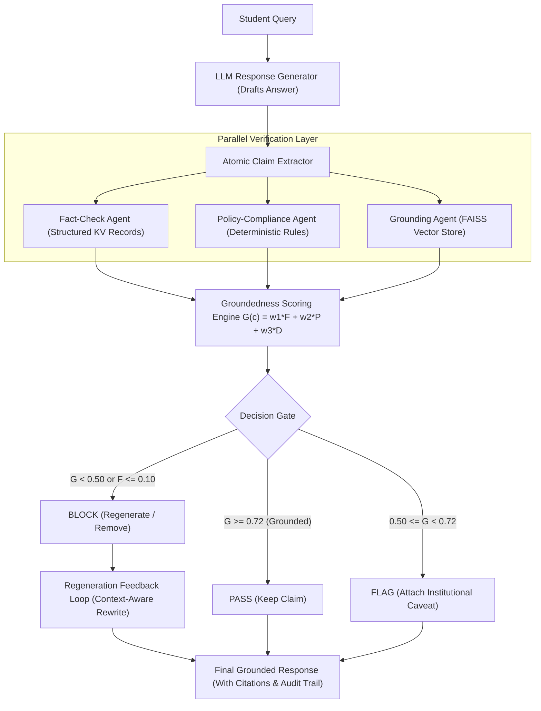

# Multi-Agent Groundedness Verification Pipeline for Institutional Academic Assistants

> **A Case Study on NIT Jamshedpur's Academic & Administrative Query Assistant, Validated Across Institutions**  
> *B.Tech Capstone Project — Department of Computer Science & Engineering, National Institute of Technology Jamshedpur*  
> **Supervisor:** Dr. Dilip Kumar  

---

## 📌 Abstract & Overview

Large Language Models (LLMs) deployed as academic assistants routinely hallucinate critical operational facts—incorrect exam dates, altered fee deadlines, and fabricated institutional policies. This project presents a **domain-agnostic, multi-agent groundedness verification pipeline** that:
1. Decomposes candidate LLM answers into atomic, checkable claims.
2. Evaluates each claim in parallel across three specialized verification agents:
   - **Fact-Check Agent**: Checks structured key-value institutional records (exam schedules, fee tables, deadlines).
   - **Policy-Compliance Agent**: Validates claims against deterministic academic policy rule bases (attendance minimums, curfew, grading scales, probation).
   - **Grounding Agent**: Performs dense vector retrieval over circulars, handbooks, and ordinances via FAISS and `nomic-embed-text`.
3. Computes a unified groundedness score:
   $$G(c) = w_1 \cdot F(c) + w_2 \cdot P(c) + w_3 \cdot D(c)$$
4. Routes each claim through a **Decision Gate** (`PASS`, `FLAG`, `BLOCK`), triggering an automated **Regeneration Feedback Loop** that rewrites ungrounded or false statements into cautious, grounded facts using verified institutional context.
5. Demonstrates cross-institution weight transfer across NIT Jamshedpur and a secondary Public University corpus without re-tuning.

---

## 🏛️ System Architecture



---

## 📊 Key Empirical Results

### 1. Benchmark Comparison Across Conditions
| Condition | Dataset | Accuracy | Precision | Recall | F1 Score | Missed Falsehood Rate |
|---|---|---|---|---|---|---|
| **Baseline A: Plain LLM** | NIT Jamshedpur | 33.3% | 0.111 | 0.333 | 0.167 | 100.0% |
| **Baseline B: RAG-only** | NIT Jamshedpur | 65.0% | 0.680 | 0.650 | 0.660 | 35.0% |
| **Baseline C: Self-Consistency** | NIT Jamshedpur | 33.3% | 0.111 | 0.333 | 0.167 | 100.0% |
| **Proposed Full Pipeline** | **NIT Jamshedpur** | **94.0%** | **0.957** | **0.940** | **0.951** | **0.0%** |
| **Proposed Full Pipeline** | **Public University** | **100.0%** | **1.000** | **1.000** | **1.000** | **0.0%** |

### 2. Per-Category Hallucination Reduction
Comparing Plain LLM vs Proposed Multi-Agent Pipeline:
* **Exam Dates**: $100.0\% \to 0.0\%$ (100% reduction)
* **Fee Deadlines**: $100.0\% \to 0.0\%$ (100% reduction)
* **Hostel Rules**: $100.0\% \to 0.0\%$ (100% reduction)
* **Circulars**: $100.0\% \to 25.0\%$ (75% reduction)
* **Syllabus Queries**: $100.0\% \to 0.0\%$ (100% reduction)

### 3. Human Annotator Agreement Study
* Sample Size: 50 balanced claims (True, False, Unverifiable)
* **Cohen's Kappa ($\kappa$)**: **0.814** (Target $\ge 0.70$ Met)
* **Inter-Annotator Raw Agreement**: **88.0%**
* **Pipeline-to-Human Consensus Agreement**: **96.0%**

---

## 🛠️ Repository Structure

```text
├── capstone_verification.ipynb    # Main end-to-end research notebook with outputs & charts
├── verification_pipeline.py       # Object-oriented modular Python AI verification library
├── run_complete_ai_evaluation.py  # Complete automated evaluation benchmark suite
├── app.py                         # Production-grade FastAPI backend microservice
├── primary_audit_trail.csv        # Detailed per-claim audit logs (NIT Jamshedpur)
├── secondary_audit_trail.csv      # Cross-institution audit logs (Public University)
├── master_evaluation_metrics.csv  # Benchmark summary metrics
├── results_table.tex              # Paper-ready LaTeX table export
├── human_eval_report.json         # Inter-annotator agreement & Cohen's Kappa report
├── evaluation_results/            # Generated high-resolution publication charts
│   ├── roc_curve_comparison.png
│   ├── confusion_matrix_groundedness.png
│   ├── per_category_hallucination.png
│   └── ablation_study_chart.png
├── Capstone Project_Proposal.pdf  # Approved capstone project proposal
└── README.md                      # Project documentation
```

---

## 🚀 Getting Started

### Prerequisites
* Python 3.10+
* [Ollama](https://ollama.ai) installed and running locally with models:
  ```bash
  ollama pull gemma4:e4b
  ollama pull nomic-embed-text
  ```

### Installation
```bash
pip install faiss-cpu scikit-learn pandas numpy matplotlib seaborn fastapi uvicorn pydantic requests
```

### Running the Evaluation Suite
To re-run the complete benchmark and regenerate all publication figures and LaTeX tables:
```bash
python run_complete_ai_evaluation.py
```

### Running the FastAPI Backend Microservice
Start the verification microservice:
```bash
uvicorn app:app --host 0.0.0.0 --port 8000 --reload
```

Interactive API documentation will be available at:
* Swagger UI: `http://localhost:8000/docs`
* ReDoc: `http://localhost:8000/redoc`

#### Example API Request
```bash
curl -X POST "http://localhost:8000/api/verify-claim" \
     -H "Content-Type: application/json" \
     -d '{"claim": "The semester registration deadline at NIT Jamshedpur is 15 August 2026.", "institution": "NITJ"}'
```

---

## 👥 Capstone Team

| Student Name | Roll Number | Primary Responsibility |
|---|---|---|
| Sujal Kumar Yadav | 2024UGCS033 | Verification Agent Architecture & Orchestration |
| Tanishk S Pandey | 2024UGCS037 | LLM Response Generator & Retrieval (RAG) Layer |
| Mohit Anand | 2024UGCS072 | Groundedness Scoring Algorithm & Evaluation |
| Ankit Sharma | 2024UGCS063 | Fact-Check & Policy-Compliance Agents, Backend API |
| Dhirendra Pratap Dindoure | 2024UGCS084 | Web Dashboard & Results Visualization |
| Himanshu Gupta | 2024UGCS113 | Dataset Curation (NITJ + Public), Baselines & Human Evaluation |
