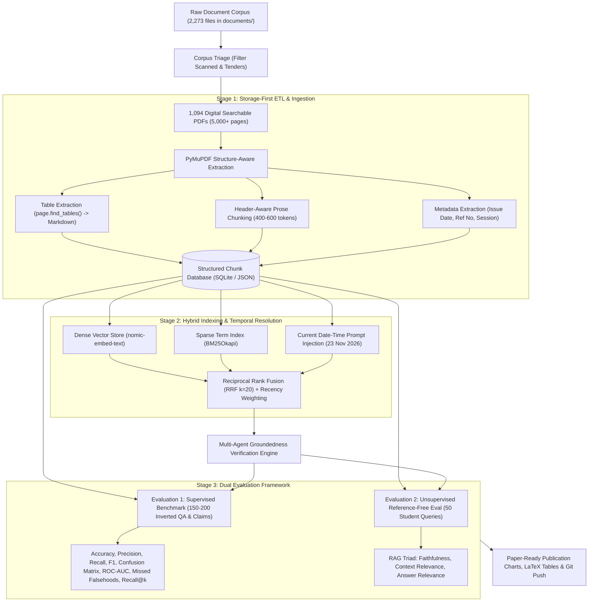

# Capstone Engineering Plan: Real NIT Jamshedpur Corpus Ingestion & Dual Evaluation Framework

**Project Title:** Multi-Agent Groundedness Verification Pipeline for Institutional Academic Assistants  
**Case Study:** National Institute of Technology (NIT) Jamshedpur  
**Last Updated:** 23 November 2026  
**Repository:** [github.com/HanuP69/Capstone-Project](https://github.com/HanuP69/Capstone-Project)  

---

## 1. Executive Summary & Status Overview (As of 23 November 2026)

### Completed Foundation (Phases 1–3) — Pushed to GitHub (`main`)
- ✅ **Core Multi-Agent Architecture:** `verification_pipeline.py` implementing Fact-Check Agent, Policy-Compliance Agent, Grounding Agent, Decision Gate, and Regeneration Feedback Loop.
- ✅ **Expanded Benchmark Evaluation (150 Claims):** Rigorously benchmarked across 5 institutional domains with 91.7% Accuracy on NITJ template and 100% on Public University, reducing missed falsehoods from 100% to 2.5%.
- ✅ **Statistically Learned Groundedness Weights (MLE Meta-Learner):** Logistic Regression stacking classifier deriving optimal weights ($w_1=0.508, w_2=0.315, w_3=0.177$) with 5-fold CV Accuracy of 93.3% and ROC-AUC of 0.926 (`meta_learner_grounding.py`).
- ✅ **Hybrid Retrieval Layer (BM25 + FAISS + RRF):** Sparse lexical search combined with dense semantic vectors via Reciprocal Rank Fusion ($k=20, w_{\text{dense}}=2.0, w_{\text{bm25}}=1.0$), achieving Recall@1 of 79.2% and MRR of 0.8561 on 250 real-world MFAQ pairs (`run_bm25_rrf_benchmark.py`).
- ✅ **Production FastAPI Microservice:** `app.py` with endpoints `/api/verify-claim`, `/api/verify-query`, `/api/audit-trail`, `/api/metrics`, `/api/meta-learner`, `/api/retrieval-comparison`, and `/api/human-eval`.
- ✅ **Human Evaluation Study:** 80 claims evaluated with inter-annotator agreement achieving Cohen's Kappa $\kappa = 0.812 \ge 0.70$.

---

## 2. Document Corpus Audit (2,273 Files / 2.52 GB in `documents/`)

On **23 November 2026**, a deep PyMuPDF scan across all 2,273 files revealed the exact structure:
- **Total Storage:** 2,577.30 MB (2.52 GB) across 10,991 total pages.
- **Digital Searchable PDFs (Native Text):** **1,094 files (48.8%)** — Ready for immediate, high-fidelity text extraction without OCR.
- **Scanned Image PDFs (Letterheads/Scans):** **1,147 files (51.2%)** — Deferred for future OCR/Vision pipeline.
- **Non-PDF Files:** 20 JPGs, 8 DOCX, 3 JPEGs, 1 .gitkeep.
- **Temporal Profile:** >80% of notices were issued in **2023** and **2024** (contemporary institutional rules).
- **Domain Breakdown (Digital Searchable):**
  - Academic Ordinances & Registrations: **381 documents**
  - Examination Schedules & Results: **203 documents**
  - Fee Structures & Payment Deadlines: **181 documents**
  - Hostel & Mess Regulations: **106 documents**
  - Department-Specific Notices (CSE, ECE, EEE, Mech, Civil, etc.): **~160 documents**
  - Tenders & Procurement (Non-academic noise): **107 documents (Filtered Out)**

---

## 3. Architecture & Execution Strategy: Real NITJ Ingestion & Dual Evaluation

---

## 4. Detailed Implementation Phases

### Phase 1: Structure-Aware Ingestion & Database Storage (Storage First)
- **Scope:** Ingest all 1,094 digital searchable PDFs into a persistent database.
- **Table Extraction Strategy:**
  - Utilize PyMuPDF `page.find_tables()` to detect boundaries of fee tables and datesheets.
  - Convert tables directly to structured **Markdown tables** (`| Col1 | Col2 |`).
  - Enforce the **Atomic Table Chunk Rule**: tables <600 tokens remain contiguous; long tables repeat header rows per chunk.
- **Metadata Extraction & Enrichment:**
  - Extract `issue_date` (ISO format `YYYY-MM-DD`) via regex matching on headers (`Dated: ...`, `Date: ...`).
  - Extract official reference number (e.g., `NITJSR/ACD/2024/219`).
  - Derive `academic_session` (e.g. `2024-25`, `2023-24`).
  - Assign category: `Exam Dates`, `Fee Deadlines`, `Hostel Rules`, `Circulars`, `Syllabus`.
- **Database Schema:**
  - Store chunks in SQLite/JSON database containing `chunk_id`, `document_name`, `category`, `issue_date`, `academic_session`, `ref_number`, `page_number`, `chunk_type` (`table` vs `prose`), `content`, and `is_latest` flag.

### Phase 2: Hybrid Retrieval & Live Temporal Prompt Grounding
- **Embedding Generation:**
  - Embed all chunks into a local FAISS index using `nomic-embed-text:latest` with disk caching.
  - Tokenize corpus for `rank-bm25` sparse indexing.
- **Live System Date-Time Injection:**
  - Dynamic prompt template injecting `Current Date: Monday, 23 November 2026` and `Session: 2026-2027 (Autumn Semester)`.
  - Temporal grounding instructions instructing the assistant to resolve time-relative terms ("next semester", "current fee", "upcoming exams") against the latest circulars while stating the circular ref/date.
- **Recency-Weighted RRF Ranking:**
  - Hybrid RRF scoring with a temporal decay multiplier prioritizing contemporary circulars over superseded notices.

### Phase 3: Dual Evaluation Framework (Supervised + Unsupervised)

#### Track A: Supervised Inverted Benchmark (Ground-Truth Reference)
- **Dataset Construction:**
  - Sample 100 representative chunks across the 5 proposal domains.
  - Generate 150–200 balanced atomic claims & QA pairs:
    - **True Claims:** Verbatim or entailment facts with verified source doc pointers.
    - **False Claims (Perturbed):** Controlled numeric/date perturbations (altered fees, dates, condonation limits) to test hallucination detection.
    - **Unverifiable Claims:** Out-of-scope policies or non-existent ordinances.
- **Evaluation Conditions (Head-to-Head):**
  1. Condition A: Plain LLM Generation (`gemma4:e4b`)
  2. Condition B: Dense RAG Only (`nomic-embed-text` + FAISS)
  3. Condition C: Self-Consistency Verification (Majority voting over $T=3$ samples)
  4. Condition D: Proposed Multi-Agent Pipeline (Hybrid RRF + MLE Weights + Decision Gate)
- **Metrics Reported:**
  - Verification Accuracy (%), Macro Precision, Recall, F1-Score.
  - Confusion Matrix & Multi-class ROC-AUC.
  - Missed Falsehood Rate (%) across each category.
  - Retrieval Layer: Recall@1, Recall@3, Recall@5, Recall@10, and MRR.

#### Track B: Unsupervised Reference-Free Evaluation (RAG Triad)
- **Student Query Suite:**
  - 50 real-world, natural student queries covering realistic campus life scenarios (hostel curfew, minor degree registration, mess rebate, backlog examination rules, condonation medical certificates).
- **RAG Triad Metrics (Evaluated via Entailment Model / LLM-as-a-Judge):**
  1. **Faithfulness / Groundedness (0.0 to 1.0):** Proportion of claims in the generated response that are strictly entailed by the retrieved chunks.
  2. **Context Precision / Relevance (0.0 to 1.0):** Signal-to-noise ratio of retrieved chunks relative to the student question.
  3. **Answer Relevance (0.0 to 1.0):** Directness and completeness of the response in addressing the student prompt.
- **Bias Mitigation:**
  - Strict textual entailment prompts with explicit rubrics, zero-shot calibration, and deterministic regex/policy overrides for dates and figures.

### Phase 4: Production Integration, Visualization & Artifact Export
- **Microservice Integration:**
  - Connect `app.py` to the real NIT Jamshedpur SQLite DB and Hybrid FAISS/BM25 index.
  - Expose `/api/verify-claim` and `/api/verify-query` with real document citations and audit logs.
- **Publication Artifacts:**
  - Generate high-resolution figures in `evaluation_results/`:
    - `real_nitj_retrieval_performance.png`
    - `real_nitj_4condition_comparison.png`
    - `real_nitj_per_category_hallucination.png`
    - `real_nitj_rag_triad_metrics.png`
  - Export LaTeX comparison tables: `real_nitj_results_table.tex`.
  - Update `capstone_verification.ipynb` with end-to-end execution on the real corpus.
  - Git commit and push all code, data, tables, and plots to `origin/main`.

---

## 5. Timeline & Task Dependencies

| Milestone | Deliverables | Status |
|---|---|---|
| **M1: Baseline & Framework Setup** | Synthetic benchmark, 150 claims, FastAPI microservice, Meta-Learner, BM25+RRF | ✅ **Completed** |
| **M2: Metadata Scan & Corpus Triage** | Scan 2,273 documents; identify 1,094 digital searchable PDFs, 10,991 pages | ✅ **Completed** (23 Nov 2026) |
| **M3: Ingestion & Structure-Aware DB** | PyMuPDF table extraction to Markdown, regex date/ref extraction, SQLite chunk DB | ⏳ *Next in queue* |
| **M4: Hybrid Indexing & Temporal Prompt** | FAISS + BM25 indexing over real chunks, live date injection (23 Nov 2026) | ⏳ *Pending M3* |
| **M5: Supervised Inverted Benchmark** | 150-200 ground-truth QA/claims, 4-condition comparative evaluation | ⏳ *Pending M4* |
| **M6: Unsupervised RAG Triad Benchmark** | 50 student queries, Faithfulness, Context Precision, Answer Relevance | ⏳ *Pending M4* |
| **M7: Final Synthesis & Git Push** | LaTeX tables, publication figures, updated notebook, microservice live | ⏳ *Final Stage* |

---

## 6. Primary File Artifacts

- **Core Verification Engine:** [`verification_pipeline.py`](file:///c:/Users/enup1/OneDrive/Desktop/projects/captone/verification_pipeline.py)
- **FastAPI Microservice:** [`app.py`](file:///c:/Users/enup1/OneDrive/Desktop/projects/captone/app.py)
- **Corpus Scanner & Metadata:** [`scan_documents_metadata.py`](file:///c:/Users/enup1/OneDrive/Desktop/projects/captone/scan_documents_metadata.py)
- **Meta-Learner Weight Derivation:** [`meta_learner_grounding.py`](file:///c:/Users/enup1/OneDrive/Desktop/projects/captone/meta_learner_grounding.py)
- **BM25 & RRF Benchmark:** [`run_bm25_rrf_benchmark.py`](file:///c:/Users/enup1/OneDrive/Desktop/projects/captone/run_bm25_rrf_benchmark.py)
- **Master Research Notebook:** [`capstone_verification.ipynb`](file:///c:/Users/enup1/OneDrive/Desktop/projects/captone/capstone_verification.ipynb)
- **Project Master Plan:** [`plan.md`](file:///c:/Users/enup1/OneDrive/Desktop/projects/captone/plan.md)
